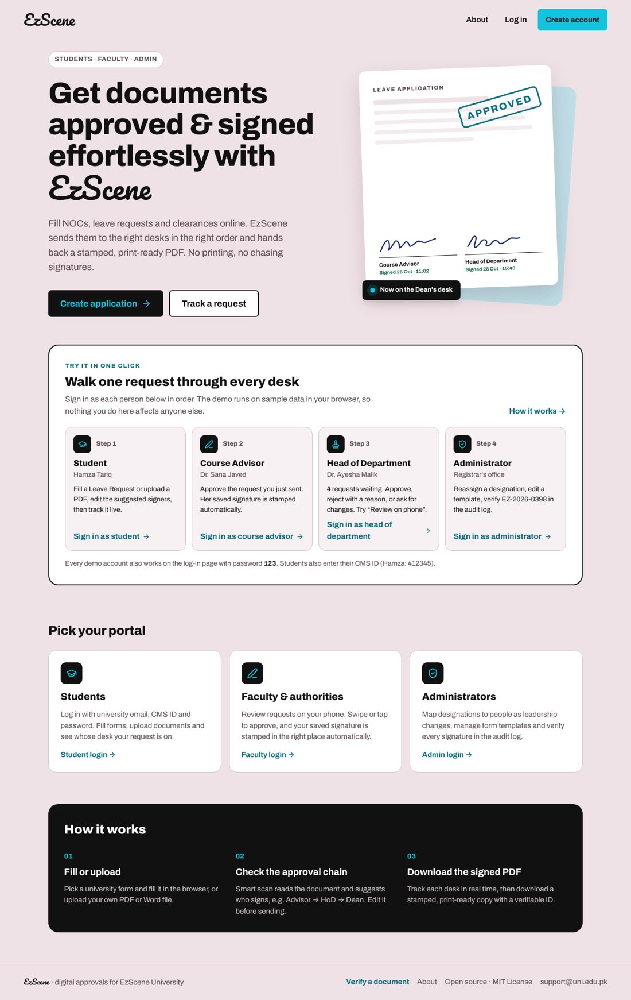
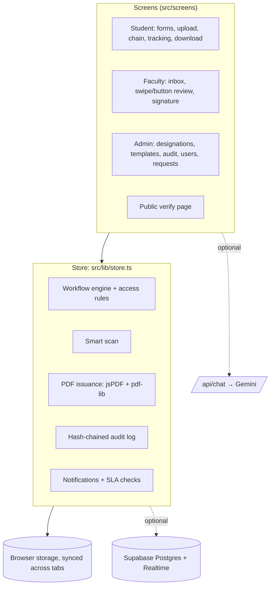
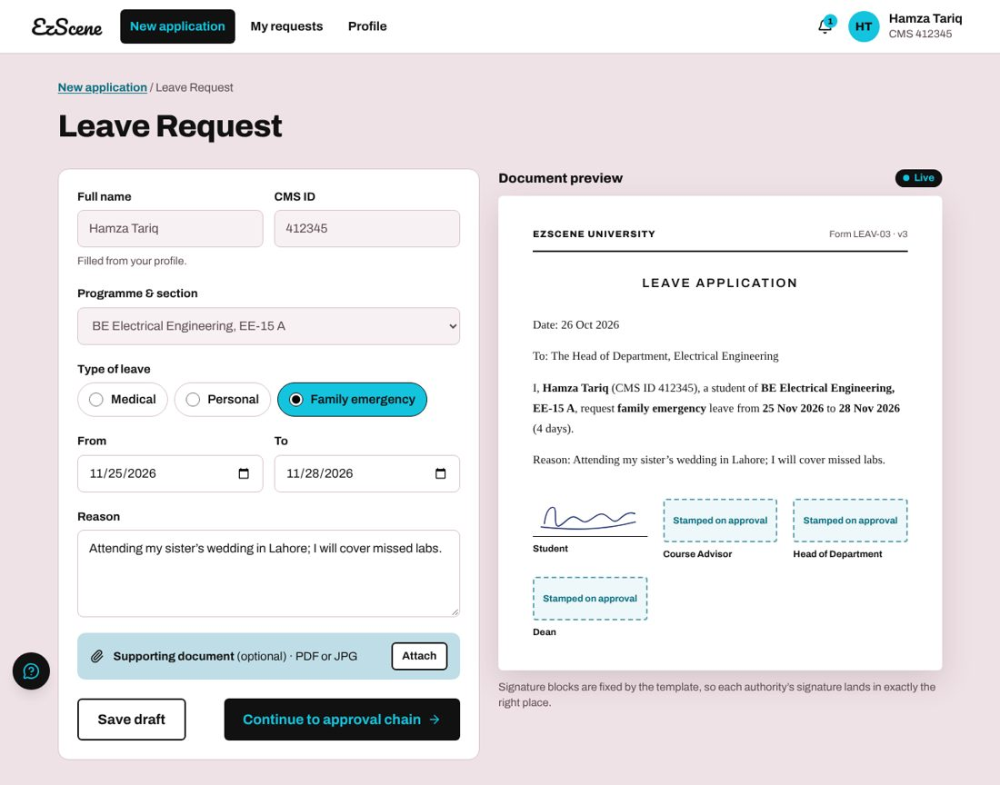
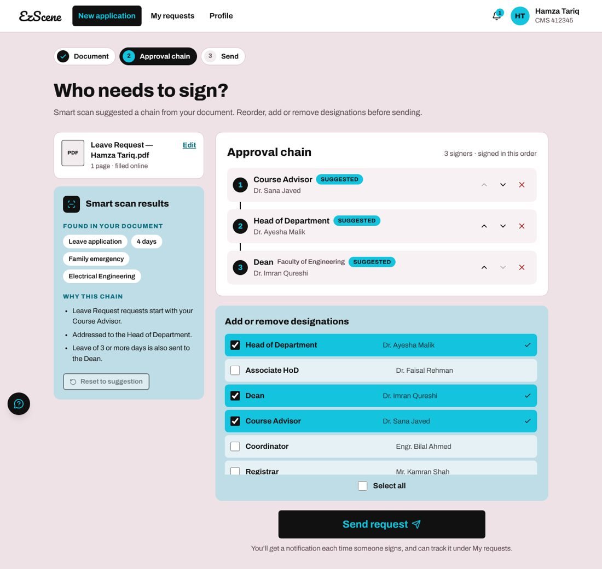
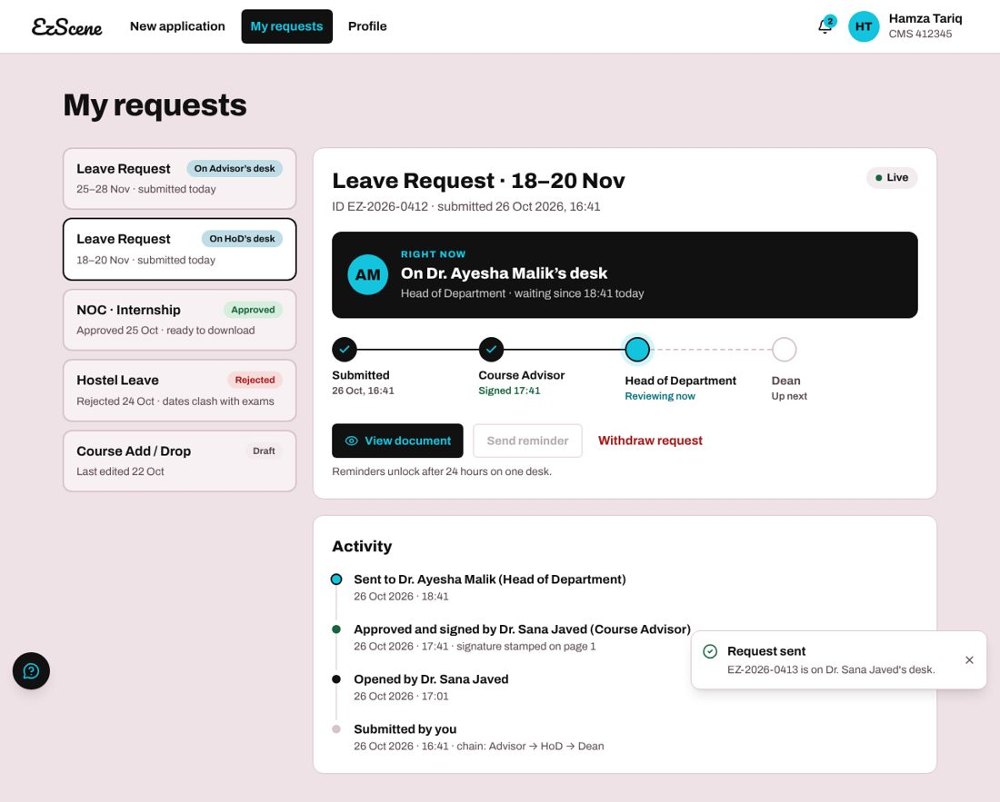
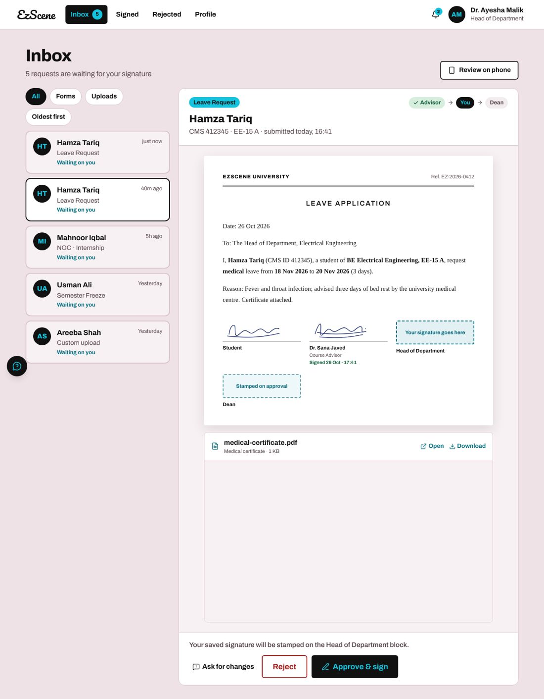
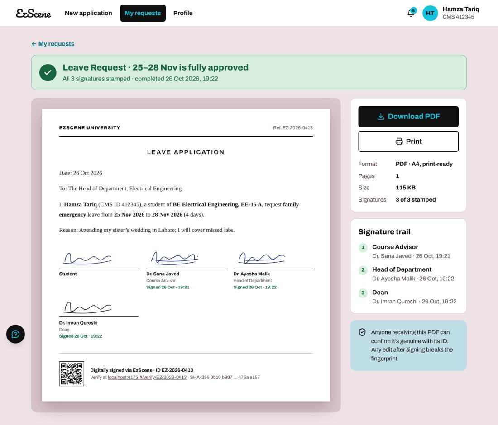
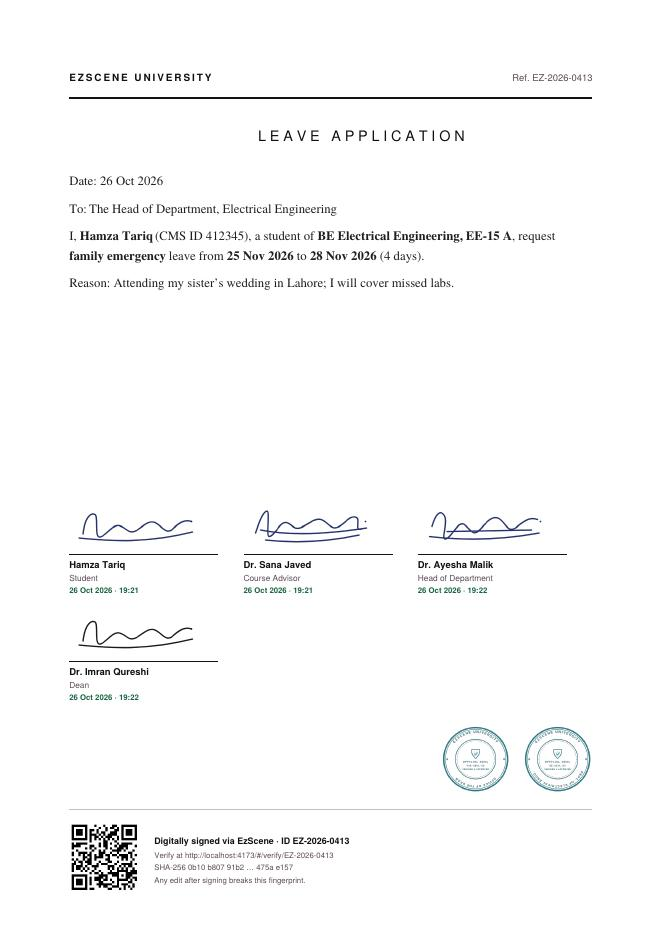
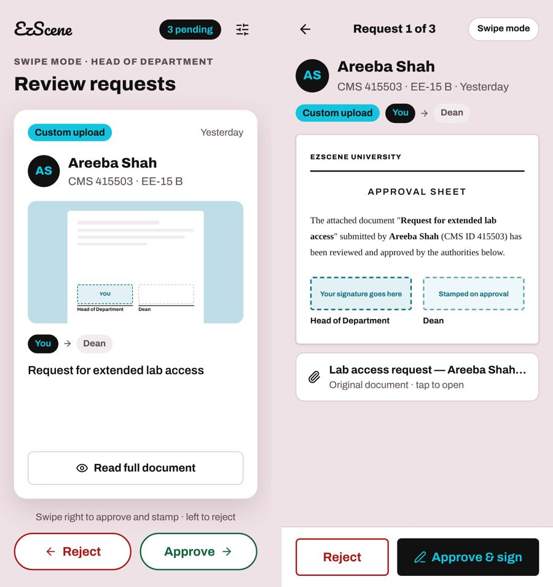
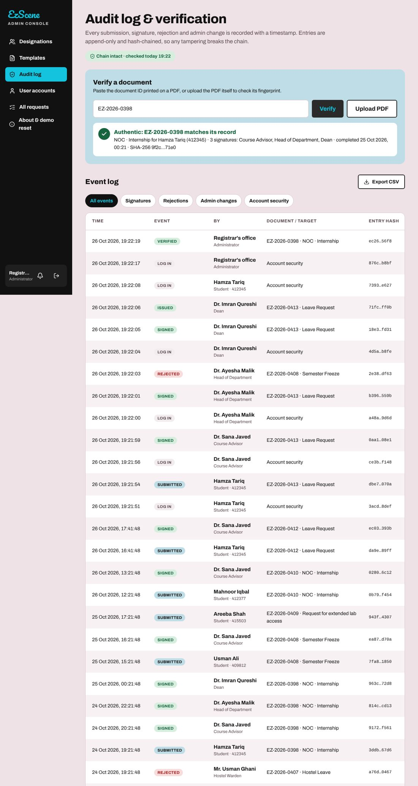

# EzScene

**Get university documents approved and signed online.** Students fill a leave
request, NOC or clearance in the browser (or upload their own PDF/Word file),
EzScene routes it to the right people in the right order, and the student
downloads a stamped, print-ready PDF that anyone can verify.

[](LICENSE)


- **Live demo:** _add your deployed URL here_
- **Demo video:** _add your recording link here_
- **Track:** Education & Accessibility (tools for students, teachers and institutions), with
  Productivity (workflow automation) overlap



---

## Contents

1. [Problem statement](#problem-statement)
2. [Solution](#solution)
3. [Technology stack](#technology-stack)
4. [Architecture](#architecture)
5. [Setup instructions](#setup-instructions)
6. [Demo](#demo)
7. [Testing](#testing)
8. [What we built vs. what we built on](#what-we-built-vs-what-we-built-on)
9. [Team contributions](#team-contributions)
10. [Kiro usage](#kiro-usage)
11. [Security and responsible development](#security-and-responsible-development)
12. [License](#license)
13. [Acknowledgements](#acknowledgements)

---

## Problem statement

At most Pakistani universities, a one-page leave application still means printing
a form and walking it from the course advisor to the head of department to the
dean, waiting outside each office. This causes four problems:

- **Students can't see progress.** Once the paper leaves their hands, nobody
  knows whose desk it is on or why it stalled.
- **Faculty sign stacks of paper**, often for requests that could be reviewed in
  seconds on a phone.
- **Leadership changes lose files.** When a head of department is replaced,
  half-signed papers get stuck with the previous holder.
- **Stamped paper is easy to forge and hard to check.** An employer or embassy
  receiving a NOC has no quick way to confirm it is genuine.

**Intended users:** students; faculty and authorities (course advisors,
coordinators, HoDs, deans, registrar, hostel wardens); the registrar's office
that runs the process; and anyone who receives a document and needs to verify it.

## Solution

EzScene puts the whole route online, from the form to the verified PDF.

| Who | What they can do |
|---|---|
| **Student** | Fill one of six university forms with a live preview of the final letter, or upload their own PDF/Word file · see a **suggested approval chain** with the reason for each signer, then reorder, add or remove signers · track live whose desk it is on and since when · send a reminder after 24 hours on one desk · withdraw · edit and resend when a signer asks for changes · download or print the stamped PDF |
| **Faculty / authority** | Save a signature once (draw it, or upload a PNG; white backgrounds are removed) · desktop inbox with filters · **Approve & sign** stamps their own signature in their own block, plus the department seal for head-level roles · reject with a reason, or ask for changes · **phone review**: swipe right to approve, left to reject, or read the full document and tap a button |
| **Registrar's office (admin)** | Map **designations** to people; reassigning one moves all pending requests to the new holder while past signatures stay with whoever signed · manage **form templates** (fields, letter text, default chain, versioning, upload a source PDF/Word) · **hash-chained audit log** with filters and CSV export · verify a document by ID or by uploading the PDF · manage user accounts · see every request and run a deadline (SLA) check |
| **Anyone** | Open the QR code on a PDF, or go to `#/verify/<ID>`, to check that a document is genuine |

### How it works

1. **Fill or upload.** Profile data (name, CMS ID, programme) fills in automatically.
2. **Check the chain.** A rule-based scan reads the form fields, or the text
   extracted from an uploaded PDF or `.docx` in the browser, and proposes the
   signers. Example: a leave of 3 or more days adds the Dean, with that reason shown.
3. **Sign in order.** Each desk is notified in turn. Every decision is checked
   against access rules: only the person assigned to the current stage can
   decide on it, and the admin can never sign.
4. **Issue.** After the last signature, a vector PDF is drawn with every
   signature in its block, department seals, a QR code, the document ID and a
   SHA-256 fingerprint. For uploaded PDFs the original pages are kept and the
   signed approval sheet is appended.
5. **Verify.** The verification page matches the ID, or the SHA-256 of the
   uploaded file byte for byte, so an edited PDF fails.

A note on the "smart scan": it is a transparent, rule-based keyword and field
analysis (see `src/lib/smartScan.ts`), not a machine-learning model. Every
suggestion comes with its reason so students can judge it.

## Technology stack

| Layer | Technology |
|---|---|
| Language | TypeScript |
| UI | React 19, Tailwind CSS 4, lucide-react icons, Archivo + Pacifico fonts (bundled) |
| Build | Vite 8 (plus `vite-plugin-singlefile` for a one-file build) |
| Documents | jsPDF (vector PDF), pdf-lib (merging with uploaded PDFs), qrcode |
| Integrity | Web Crypto SHA-256 (PDF fingerprints), js-sha256 (audit hash chain) |
| Data | Browser storage by default; optional Supabase (Postgres + Realtime) |
| AI (optional) | Google Gemini through a server-side function (`api/chat.ts`); the key never reaches the browser |
| Testing | Vitest (unit), Playwright (end-to-end walkthrough), GitHub Actions CI |

## Architecture



- **Single source of truth.** `src/lib/store.ts` holds all state and every
  state transition (submit, approve, reject, request changes, reassign,
  withdraw, issue). Screens only read state and call store actions.
- **Access rules in one place.** `src/lib/access.ts` is used by both the UI and
  the store, so a hidden button can't be bypassed.
- **Offline first.** Without configuration everything runs in the browser and
  updates live across tabs. With Supabase, every change is written through and
  other devices update in realtime (`src/lib/cloud.ts`).

More detail, including the data model: [docs/ARCHITECTURE.md](docs/ARCHITECTURE.md).

## Setup instructions

Requirements: Node.js 20 or newer, npm.

```bash
git clone <your-repo-url> ezscene
cd ezscene
npm install
npm run dev            # http://localhost:3000
```

That's all you need for the demo. Optional configuration goes in `.env`
(copy `.env.example`):

| Variable | Purpose |
|---|---|
| `VITE_SUPABASE_URL`, `VITE_SUPABASE_PUBLISHABLE_KEY` | Shared database across devices. First run `supabase/schema.sql` in the Supabase SQL editor; the app seeds an empty database on first connect. Check with `npm run db:check`. |
| `GEMINI_API_KEY`, `GEMINI_MODEL` | Help assistant answers (server side only). Without a key it uses built-in help text. Run `npm run dev:ai` alongside `npm run dev` locally. |
| `VITE_UNIVERSITY_NAME`, `VITE_SUPPORT_EMAIL`, `VITE_PUBLIC_URL` | Branding and the URL printed in PDF QR codes |
| `VITE_DEMO_MODE` | `false` hides the one-click demo accounts |
| `VITE_REPO_URL` | GitHub link shown in the footer and About page |

**Production build:** `npm run build` writes a static site to `dist/`. Deploy it
to any static host. On Vercel, `vercel.json` also deploys `api/chat.ts`.
`npm run build:single` writes the whole app as one HTML file to `dist-single/`.

## Demo

**Fastest path:** open the site and use the **"Try it in one click"** panel on
the landing page. Sign in as each person in order to walk one request through
every desk. The About page (`#/about`) explains the problem, the flow and the
architecture inside the app.

Demo accounts (password `123`; they are sample data, not real credentials):

| Portal | Email | Notes |
|---|---|---|
| Student | hamza.tariq@student.uni.edu.pk | CMS ID `412345` |
| Course Advisor | sana.javed@uni.edu.pk | |
| Head of Department (EE) | ayesha.malik@uni.edu.pk | 4 requests waiting |
| Dean | imran.qureshi@uni.edu.pk | |
| Associate HoD | faisal.rehman@uni.edu.pk | No saved signature, so shows the signature onboarding |
| Admin | admin@gmail.com | |

Suggested 3-minute walkthrough:

1. **Student:** New application → Leave Request → pick dates 3+ days apart → see
   the Dean added with its reason → Send request.
2. **Course Advisor → HoD → Dean:** open the request and press Approve & sign.
   Try the HoD's "Review on phone" swipe mode.
3. **Student:** My requests shows the progress and activity; open the approved
   document and download the PDF.
4. **Admin:** Audit log → verify the ID, or upload the downloaded PDF. Upload
   any other PDF (or one edited after download) and verification fails.
5. **Admin:** Designations → move Head of Department to Dr. Faisal Rehman and
   watch the pending requests move to him.

| | |
|---|---|
|  |  |
| Form with live document preview | Suggested approval chain with reasons |
|  |  |
| Live tracking: whose desk, since when | Faculty inbox with "Your signature goes here" |
|  |  |
| Approved document page | The issued PDF: signatures, seals, QR, fingerprint |
|  |  |
| Phone review: swipe and button modes | Hash-chained audit log and verification |

## Testing

```bash
npm test               # 18 unit tests (Vitest)
npm run lint           # TypeScript type check
npm run check:secrets  # fails if anything looks like a real key or token
npm run build && npx vite preview --port 4173 &
npm run test:e2e       # Playwright walkthrough of every portal (needs `playwright`)
```

The unit tests cover the parts most likely to break quietly: the full
three-signer workflow and PDF issuance record, access rules (wrong desk,
admin, missing signature, who can see a request), rejection and notifications,
designation reassignment, the smart-scan suggestions, letter text rendering,
password-reset codes, and **audit-log tamper detection** (editing an old entry
breaks the chain). The end-to-end script drives a real browser through
student → advisor → HoD → dean → download → admin verification by file →
reassignment → signature onboarding → password reset → phone review, and saves
screenshots to `test-results/`. CI runs all of it on every push
(`.github/workflows/ci.yml`).

## What we built vs. what we built on

EzScene combines two pieces of the team's own earlier work and adds substantial
new functionality. The brief asks teams to identify their contributions
clearly, so here they are.

**Carried over from our earlier ApplyEase project** (backend layer):
the store pattern, Supabase write-through and realtime sync (`cloud.ts`,
`supabase.ts`), the business-hours SLA engine (`slaEngine.ts`), the image
transparency processor for signatures and seals (`imageProcessor.ts`), toast
notifications, the Gemini endpoint (`api/chat.ts`) and the base database schema.

**Carried over from our EzScene UI design:** the visual design and layout of
the 17 screens (landing, login, password reset, signature onboarding, profile,
new application, form, approval chain, approval-mode chooser, swipe and button
modes, faculty inbox, tracking, approved download, designations, templates,
audit log).

**New in this project:**

- Every screen implemented as working React components wired to the store
  (the design was static mock-ups).
- **Designations** as a first-class concept, including reassignment that moves
  pending work, with a new Supabase table.
- **Student-chosen approval chains** and the rule-based **smart scan**,
  including in-browser text extraction from PDFs and `.docx` files.
- Rewritten **access rules**: every approver signs with their own saved
  signature, and the admin never signs.
- New **PDF renderer** matching the design, with **pdf-lib merging** for
  uploaded PDFs, plus **SHA-256 file fingerprints** and verify-by-upload.
- **Hash-chained audit log** with tamper detection.
- Drafts, reminders, withdrawal, request-changes and resubmission, password
  reset with one-time codes, student self-registration, phone swipe review,
  cross-tab live sync, the public verification page, the About page and the
  one-click demo.
- New seed data, unit tests, the end-to-end script, CI, the secret scanner
  and this documentation.

## Team contributions

> **Team: please fill this in before submitting.** The judging criteria give
> marks for evidence that every member contributed meaningfully, and the brief
> disqualifies misrepresented contributions, so list what each person actually did.

| Member | Role | Contributions |
|---|---|---|
| _Name_ | _e.g. Backend / workflow_ | _e.g. ApplyEase engine, Supabase sync, SLA engine_ |
| _Name_ | _e.g. Design_ | _e.g. EzScene UI design (17 screens)_ |
| _Name_ | _e.g. Frontend_ | _e.g. screen implementation, phone review_ |
| _Name_ | _e.g. Docs / testing / demo_ | _e.g. README, tests, demo video_ |

## Kiro usage

> **Team: describe how you used Kiro, if you did.** The brief awards up to 10
> marks for meaningful Kiro use and asks you to explain where it helped. Leave
> this section out if you didn't use it.

The earlier ApplyEase project was developed in **Kiro IDE**, using its AI
features for assisted development, together with GitHub Copilot.
_Add specifics: which specs, hooks or agent sessions you used, and for what._

This EzScene integration, including the screen implementation, extensions,
tests and documentation, was produced with the help of an AI assistant
(Anthropic's Claude) working from the team's ApplyEase code and EzScene
design. All code was reviewed and tested by the team, who remain responsible
for it. AI-assisted development tools are permitted by the brief (section 9).

## Security and responsible development

- **No secrets in the repository.** Keys are read from the environment only;
  `.env*` is git-ignored; `npm run check:secrets` runs in CI. The Gemini key is
  used only server-side in `api/chat.ts`.
- **Demo credentials are sample data.** The seeded accounts use the password
  `123` so judges can sign in. Change or remove them before real use
  (`src/lib/constants.ts`), and set `VITE_DEMO_MODE=false`.
- **Known prototype limits** (the brief notes projects don't need to be
  production-ready):
  - Authentication is application-level against the `profiles` table, and the
    sample row-level security policies are open. For production, move to
    Supabase Auth, hash passwords and add per-role policies.
  - Password-reset codes are generated, expire after 10 minutes and are
    verified, but no email service is connected, so the code is shown on
    screen. Connect a provider in `requestPasswordReset` (`src/lib/store.ts`).
  - Uploaded files are stored inside the request record, which is fine for a
    few MB. Large scans should go to Supabase Storage.

## License

Released under the [MIT License](LICENSE). Third-party packages keep their own
licenses; see [THIRD_PARTY_NOTICES.md](THIRD_PARTY_NOTICES.md).

## Acknowledgements

- [React](https://react.dev), [Vite](https://vite.dev), [Tailwind CSS](https://tailwindcss.com) (MIT)
- [jsPDF](https://github.com/parallax/jsPDF), [pdf-lib](https://pdf-lib.js.org), [node-qrcode](https://github.com/soldair/node-qrcode), [js-sha256](https://github.com/emn178/js-sha256) (MIT)
- [Supabase JS](https://github.com/supabase/supabase-js) (MIT), [Google Gen AI SDK](https://github.com/googleapis/js-genai) (Apache-2.0)
- [Lucide](https://lucide.dev) icons (ISC)
- [Archivo](https://fonts.google.com/specimen/Archivo) and [Pacifico](https://fonts.google.com/specimen/Pacifico) typefaces via Fontsource (SIL OFL 1.1)
- [Vitest](https://vitest.dev) and [Playwright](https://playwright.dev) (MIT / Apache-2.0)
- Organised as part of **Hacktoberfest Hackathon NUST × NSTP** by AWS Student Builder Group NUST

Contributions are welcome: see [CONTRIBUTING.md](CONTRIBUTING.md).
