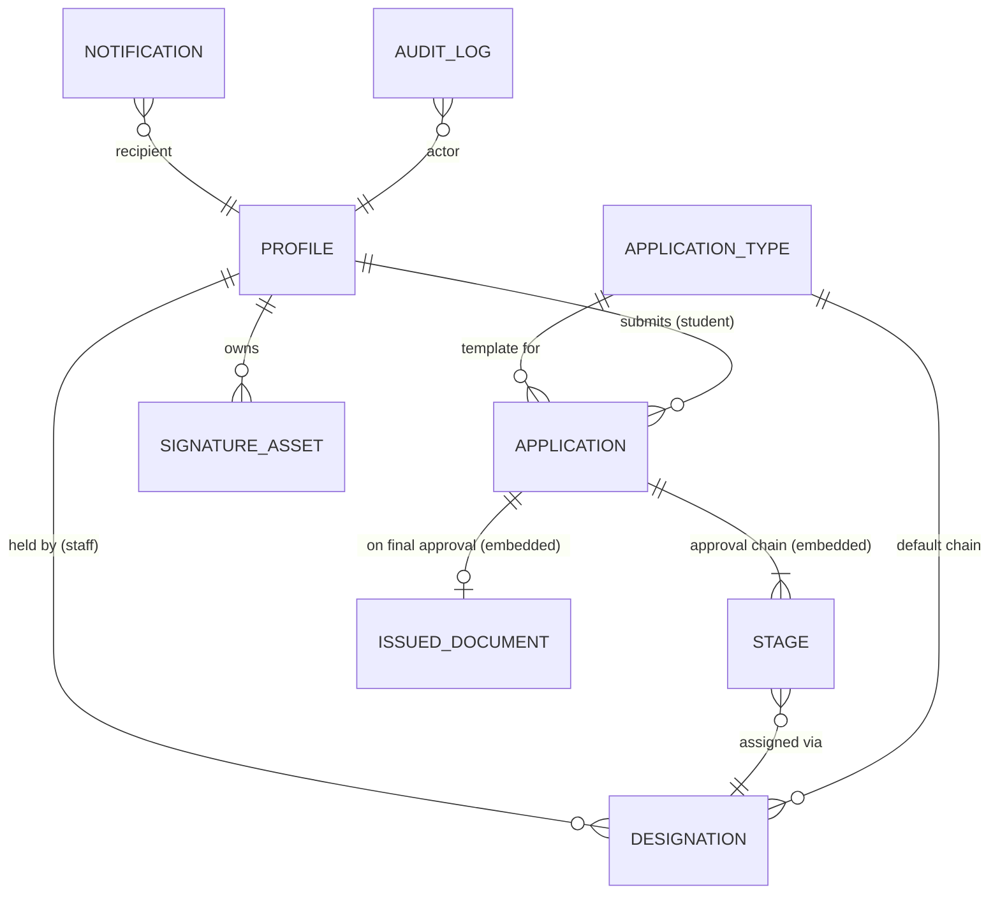
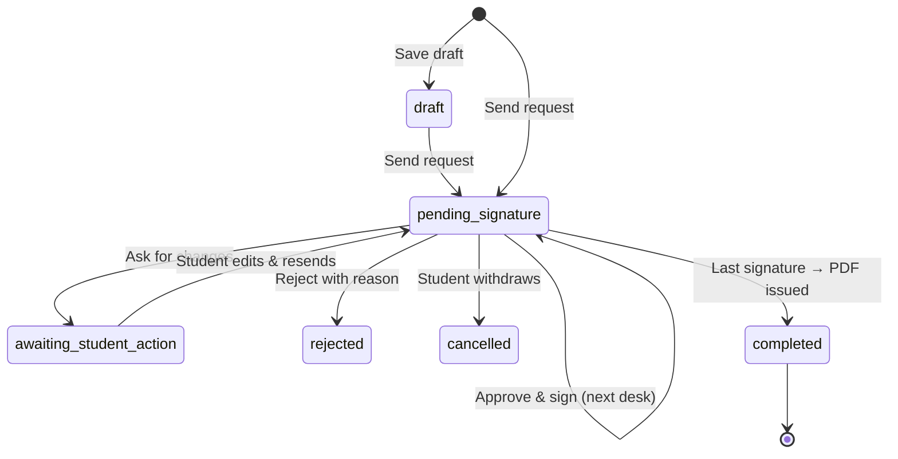

# Architecture

## Layers

| Layer | Files | Responsibility |
|---|---|---|
| Screens | `src/screens/**` | One component per screen in the EzScene design. They read state and call store actions; they never change data directly. |
| UI kit | `src/ui/*` | Buttons, fields, cards, shells (top nav / admin sidebar), document preview, signature pad, router, assistant. |
| Store | `src/lib/store.ts` | All state and every transition. Persists to browser storage, writes through to Supabase when configured, notifies subscribed components. |
| Rules | `src/lib/access.ts` | Who can see or decide on what. Used by both screens and store. |
| Domain helpers | `smartScan.ts`, `pdfGenerator.ts`, `officialPdf.ts`, `slaEngine.ts`, `imageProcessor.ts` | Chain suggestion, letter text, PDF drawing and merging, deadlines, signature transparency. |
| Sync | `cloud.ts`, `supabase.ts` | Row mapping, pull/push, realtime channels. |
| Server (optional) | `api/chat.ts`, `api/dev-server.mjs` | Gemini help assistant; the key stays on the server. |

## Data model

Tables (`supabase/schema.sql`): `profiles`, `designations`, `application_types`,
`applications` (stages, timeline, uploads and issued document are JSON columns),
`signature_assets`, `stamp_assets`, `audit_logs`, `notifications`.

## Request lifecycle

## Key decisions

- **Designations instead of hard-coded people.** A stage points at a designation
  (e.g. "Head of Department · Electrical Engineering") and its current holder.
  Reassigning moves only pending and in-progress stages, so history stays accurate.
- **The approver's own signature, always.** `ownSignature()` picks the signed-in
  user's latest active signature; there is no way to pick someone else's.
  Head-level designations (`affixesSeal`) also affix their department seal.
- **Two fingerprints per document.** `documentHash` (printed on the PDF) is a
  hash of the request content and signers. `pdfFileHash` is the SHA-256 of the
  exact PDF bytes and is what "verify by upload" compares, so any edit fails.
- **Audit hash chain.** Each entry stores `prevHash` and
  `entryHash = sha256(prevHash | id | time | actor | action | details | ref)`.
  `verifyAuditChain()` recomputes the chain and reports the first broken entry.
  It is tamper-evident, not tamper-proof: someone with database write access
  could rewrite the whole chain. Anchoring the latest hash elsewhere would
  close that gap.
- **Rule-based smart scan.** Suggestions must be explainable to a student, so
  every rule adds a human-readable reason. PDF text is read by inflating
  FlateDecode streams with the browser's `DecompressionStream`; `.docx` files are
  unzipped to read `word/document.xml`. Scanned images without a text layer fall
  back to the file name.
- **Offline first.** Browser storage is the default so the demo needs no
  setup; a `storage` event listener keeps tabs in sync. Supabase adds
  cross-device realtime with the same code paths.
